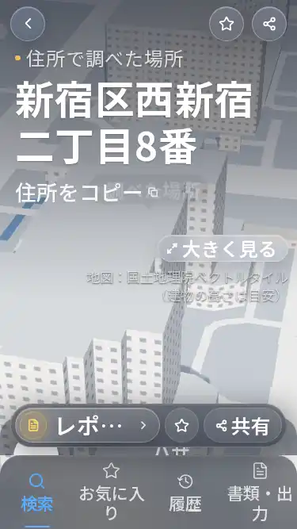

# 定期UIレビュー — 2026-11-08 09:35 JST の実行

## 対象と結論
- PR #29、開発ブランチ `claude/system-feedback-eggn72`。
- 修正前 `fbcc6a07579126fd4657a388e24331f952c2248c` → 修正後 `44ba2d7934ce8a12ddedeaafa1bde3171d24513b`。
- 対応Preview: https://michilu-6lm54nw85-sourirettes-projects.vercel.app （READY・Git SHA一致）。共有Chromeで開くとVercelログイン画面へ移るため、アプリの実画面操作は未確認。
- **未完成。PR #23 / #29はDraftを維持。mainを更新していない。**
- 新しいClaude Actions呼出しなし。最新の実Claude run 41187312208の最終modelUsageに `claude-opus-5-5` と禁止された `claude-haiku-5-5` が含まれるため、モデル要件は失敗。対策PR #28は未マージ。PR #27はmain反映済み、CLI 2.1.316、effort=max/Ultracode/Workflow設定は確認したが、各担当の実model/effortと開始終了は独立検証未完。

## 実際の変更
`components/app/mobile-app.tsx` の物件見出しを固定高から最小高へ変更し、地図操作・出典・回転ヒントを通常の縦配置にした。文字や出典は削除・縮小せず、長くなる場合は縦スクロールで読む。最初の修正案では遅れて出る回転ヒントがタブを押し下げたため、非表示中も場所を保つよう修正した。`docs/features.md` に動作を記録。

この画像はLinux静的ビルドのChromiumであり、Vercel Previewや実機iPhoneではない。昼の明るい模型上で出典等のコントラストが弱く見えるため、重なりの解消だけで視覚品質を合格にしない。

## 原因を区別したQA修正
1. 旧調査画面QA（run 42404413209）は7成功/11失敗。丸いタブの四隅を44px正方形として要求していたため、丸角の外側を親要素への誤ヒットと扱っていた。修正後は外形が44px以上であることと、上下左右・中心の実ヒットを確認する。文字重なり・横向き本文96px未満の失敗条件は残した。
2. 旧飛行QA（run 42404413249）は5成功/22失敗。22件すべてが飛行前の「入力を消す is obscured」で止まった。調査した要素は起動中の `.launch-veil`。起動演出終了を `data-launch` の状態で最大10秒待ち、入力欄の操作可能性を確認するようにした。飛行canvasを検査する条件は残す。
3. 実ブラウザの既存検証は1エンジン・1ページずつ順番に実行。CIでの静的ビルドQAはPreviewの認証や実機の代わりにはしない。

## 検証の範囲
- 最終変更と同一の2ファイルのSHA-256を検証環境と保存内容で照合。
- `git diff --check`、`npm run lint`、`npm run typecheck`、`npm test`、`npm run build`: 終了コード0。77ファイル/1,367テスト成功、8ファイル/32テストskip。ライブテストのskipを成功扱いしない。
- Linux / Playwright 1.62.0 / Chromium 151.0.7922.34 / WebKit 26.5。公開施設の東京都庁のみ使用。
- 修正済み静的ビルドの調査画面QA: **18件中16成功・2失敗**。375/390/402/430px、200%文字シミュレーション、初期化待ちの入力保持、6タブ切替、ホームへ戻るが通過。PC1024/1440はホームの簡易確認のみ。
- 844×390は両エンジンで操作が通るが、道路タブの本文が固定操作に隠れ、連続して読める高さ0pxで失敗。判定を弱めず残した。
- 200%は計算済み文字サイズを倍にする試験。iOS Dynamic Type、実ソフトキーボードとは別。
- 検証用サーバーを再ビルド後に再起動しなかった試行は旧ディレクトリを参照してHTTP応答不能となった。サーバー再起動とHTTP200確認後に全18件を再実行し、上記は再実行後の結果。
- 最新コミットの[CI 42431670206](https://github.com/ryo02suzu/real-estate-agent-Yuuri/actions/runs/42431670206)は完了・成功。15:34 JSTからの再確認でもlint/typecheck/test/build成功と1,367成功/32skipをログで確認。最新SHAの独立ActionsブラウザQAを本QAブランチ更新で起動する。
- 飛行QAのローカル試行では、起動演出待ち追加後に通常飛行・タップ終了・低減モーション等が通過した一方、ChromiumのEscape/Enter/Spaceに750ms時点の可視判定失敗が出た。後続画像の収集時にはdialogが消えている例があり、機能不良と処理遅延を未切り分け。全27件の完了結果は回収できなかったため、合否総数を確定せず、最新SHAのActionsで再現を確認する。終了条件の緩和は行わない。

## 読んだ規則と反映（今回のレビュー担当）
| Skill・文書 | 適用した具体的ルール | 変更・確認 |
| --- | --- | --- |
| michilu-ui | 小さい画面/横向き/文字拡大/タップ領域、PC表示保持、実画面未確認を明示 | mobile-app.tsx、サイズ別Chromium/WebKit、Preview認証待ちの区別 |
| systematic-debugging | 修正前に根本原因と再現を確認、CSSは実ブラウザで前後確認 | 固定高と絶対配置、丸角の誤判定、起動veil、ヒントによる移動を切り分け |
| michilu-regression | lint/typecheck/testとUI/PC確認、ネット依存のskipを区別 | 必須4コマンド、18件の調査画面QA、PCは簡易確認と記録 |
| verification-before-completion | 最新の証拠を読んでから成功を述べる | 終了コードと差分・ハッシュ確認、横向きとPreview未完を保持 |
| AGENTS.md / CLAUDE.md | 同梱Next.js文書、スマホ側に限定、機能説明更新、日本語、mainへ入れない | Next16.4.3のuse-client文書確認、変更2ファイル、docs/features.md、同じ開発ブランチ |

Claude自身の新しいスキル使用証明ではない。PR #23の既存01-status.mdには2担当の使用記録があるが、新規Claudeは起動していない。Chrome DevTools MCPは未使用。無関係な39スキルの再読・再実行はしていない。

## 残る受入条件
- 横向きの本文と操作の配分、昼背景の文字/出典のコントラスト、地図の44px操作領域。
- 最新SHAの通常飛行・キーボードスキップ・低減モーション・失敗時の証跡確認。
- PR #23との競合解消と統合SHAでの検証。
- F01〜F12全機能、各詳細→戻る、検索競合、出典と確度、PCの全操作/画素/印刷回帰。
- 認証済み最新Preview実操作、実機iPhone、実キーボードと端末文字拡大。
- 最新Previewのユーザー承認があるまでmain反映・本番デプロイを行わない。
