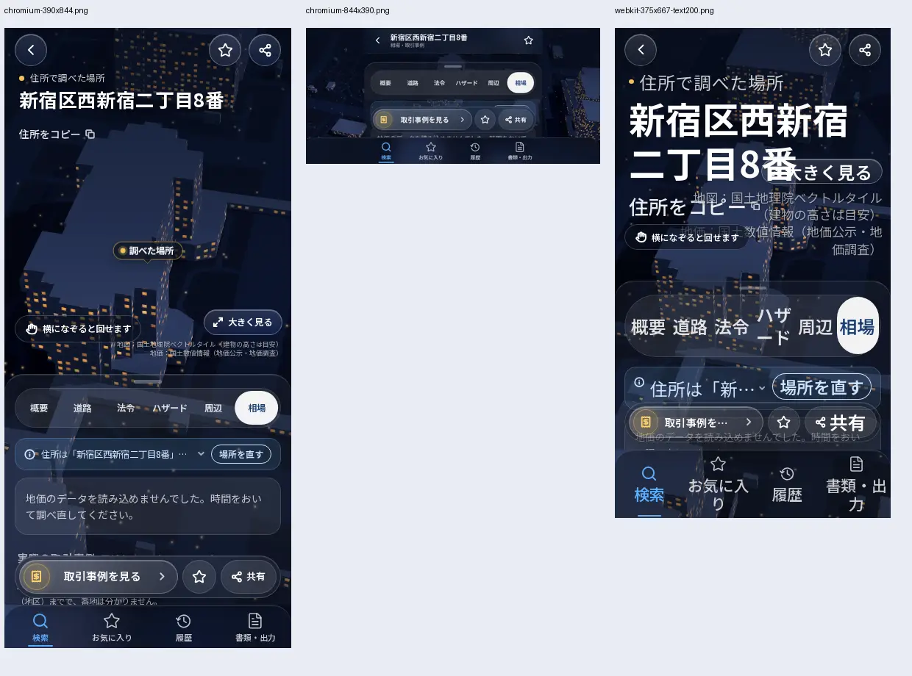

# MICHILU 調査画面のレビュー記録（2026-11-08 JST）

## 現在の判定

開発中。レビュー準備完了ではありません。PR #29 と #23 は Draft を維持します。
対象は PR #29 の `fbcc6a07579126fd4657a388e24331f952c2248c`。PR #23 へは未統合で競合が残っています。

- [対象CI](https://github.com/ryo02suzu/real-estate-agent-Yuuri/actions/runs/42383542100)：lint / typecheck / test / build 成功。1367 passed、32 skipped（ライブテスト等）。77 test files passed、8 skipped。
- [対応Preview](https://michilu-6qsh2ts80-sourirettes-projects.vercel.app)：Vercel READY、Git SHA 一致。最新デプロイの画面操作は未確認。
- 直近1時間にアプリの新しいコミットはありません。最新 `fbcc6a0` は2026-11-07 14:51 UTCの更新です。本記録とQAの更新は別のQA専用ブランチに保存します。
- main は `21ad68dd81edb4ccca96f5d9e97f961289b8c31e`。本レビューによるmain更新・本番デプロイは行っていません。

## 先に実装した修正と確認範囲

1. `01541631594040e800de713c60d30df7c78f1519`：住所コピーと6タブの実際の操作範囲を44px以上へ。固定高のタブから最小高と折返しへ変更。
2. `c451828c097c5fd1b391f7058c9673061fad273f`：タブ変更時にページ先頭へ戻す処理をなくし、必要な場合だけ調査パネル先頭へ戻す。初期化前の検索入力を無効にし、最初に入力した文字が初期化で消える現象を防ぐ。
3. 以後のコミットを比較し、上記の `mobile-app.tsx` / `frame.tsx` / `result-head.tsx` は変更されていないことを確認しました。後続の主な変更は地域データ・説明・テストです。

修正前の Linux Playwright WebKit では、初期化前の最初の入力が空に戻り、初期化後の2回目の入力では保持されました。Chromium 844×390では、タブ選択後にタブが画面外へ戻りました。

前回のローカル静的ビルド（`c1305bd` + 上記と同じUI修正）で、Chromium/WebKitを1エンジン・1ページずつ動かし、16件の操作・配置チェックと2件の初期入力チェックが通過しました。375/390/402/430px・844×390・375pxの200%文字シミュレーション、PC1024/1440pxを含みます。PCはホーム表示のみ、文字拡大は計算済みフォントサイズの2倍であり、実機iPhone、OS文字拡大、PC全機能・画素比較を代替しません。

**この16+2件は最新SHAの合格証ではありません。** 正確な `c451828` を対象に開始した追加ブラウザ実行は最終結果を回収できていないため、成功と扱いません。`c451828` の[CI](https://github.com/ryo02suzu/real-estate-agent-Yuuri/actions/runs/42376833652)と最新 `fbcc6a0` のCI成功は別途確認しています。

この画像は `c1305bd` + UI修正の静的ビルドです。最新Vercel Previewや実機iPhoneの画像ではありません。

## 画面を実際に見て残った問題

- 375px・200%文字シミュレーション：住所見出しが「大きく見る」、地図出典、回転ヒントと重なります。見出し・出典・操作を重ねず、文字量に応じた高さと読み順を確保する必要があります。
- 844×390横向き：タブの位置は維持されましたが、上部バー・タブ・下部アクション・ナビで調査本文の見える高さが不足します。横向きではパネル配分と固定領域を見直す必要があります。
- ローカル検証の相場取得はエラー表示でした。エラー表示の操作確認を、実データ取得成功に数えません。
- 日本地図から地点への演出の全フレーム品質、地図と調査パネルの対応、各結果の確度/出典、F01〜F12、検索競合、失敗/未対応、各詳細→戻る、キーボードとPC全回帰は未完です。

## 最新SHAで再検証するQA

既存の `.github/workflows/michilu-ui-review.yml` と `michilu-flight-review.yml` の対象を `fbcc6a0` に更新しました。15分監視は追加していません。これらのQAにClaudeや他のモデル呼出しはありません。

- 正確なSHAをcheckoutし、lint/typecheck/test/buildを実行。
- `scripts/qa/michilu-result-review.py`：初期化を意図的に待たせた初回入力、6タブの44px実ヒット範囲、戻る、横溢れ、200%文字時の重なり、横向き本文の露出高さを記録。
- 本文96pxは、24px×4行分を読めるかを見るレビュー用の最低目安です。仕様達成や視覚品質全体の証明ではありません。
- 既存flight QA：日本地図のcanvasが幅200px・高さ150px以下へ潰れた場合は失敗。低減モーション、スキップ、キーボード、タイル失敗等の検査を保持。
- 失敗でも画像・JSONをartifactへ保存。ブラウザは1エンジン・1ページずつ。静的ビルドQAとVercel Preview検証を区別します。
- 更新前にYAML2件、Bash、埋込Python5ブロック、新Pythonスクリプト、evaluate内JavaScriptの構文を検査し成功。ブラウザ実行結果はActions runを確認してから追記します。

## 適用したルールと証拠

これは今回のレビュー担当による適用記録です。Claudeが読んだ証拠と混同しません。

| スキル | 参照したルール | 反映・検証 |
| --- | --- | --- |
| michilu-regression | 中心導線から合格条件を具体化、低い画面/読み込み待ち/失敗を確認、未検証を成功にしない | 初期入力・検索・6タブ・戻るの新QA、最新CI確認、PC検査範囲を限定して記載 |
| michilu-map | 模型3Dを写真品質と呼ばない、出典を保持、実画面を見た場合だけ視覚確認と記載 | 画像の環境とSHAを明記、出典重なりを残課題、canvas退行検査を最新SHAへ更新 |
| michilu-privacy | 顧客住所や秘密を公開ログに載せない、認証/公開範囲を保持 | 東京都庁のみで試験、顧客データやトークンを記録しない、共有リンク作成拒否を尊重 |
| verification-before-completion | 新しい証拠なしで成功・完了と主張しない | 最新CIログ1367/32を読み、旧ローカル検証と最新未検証を区別、Draft維持 |

前回のUI修正では、michilu-uiの44px・PC分離、systematic-debuggingの原因再現、vercel-react-best-practicesのイベントハンドラ内スクロールとeffectを使わない初期化状態導出を `result-head.tsx` / `mobile-app.tsx` / `frame.tsx` に反映しました。Chrome DevToolsスキルは専用ツールが無いため未使用。代替はLinux Playwright Chromium/WebKitです。Claude自身のスキル読み込み・ルール適用記録は別途未確認の項目を残します。

## Claude / Previewのブロッカー

- 設定PR #27はmainへ反映済み。CLI 2.1.316の導入はActionsログに記録されています。Opus/maxとUltracode/Workflow設定は確認済みですが、実Workflowと各担当の開始・終了・全model/effortの独立証拠は未完です。
- 最新の実Claude Actions [41187312208](https://github.com/ryo02suzu/real-estate-agent-Yuuri/actions/runs/41187312208) の最終 `modelUsage` を今回再読し、`claude-opus-5-5` と禁止された `claude-haiku-5-5` の両方を確認。要件違反として失敗扱い、新規呼出しを保留します。対策PR #28は未マージ。外部Claudeセッション由来のコミットはActionsモデルの証明ではありません。
- 前回、保護されたPreviewを開くとVercel認証画面へ遷移しました。一時共有URLの取得は「誰でも閲覧できる共有URLによりアクセス権を拡大し、その公開は承認されていない」という自動承認審査で拒否されました。別経路で同じ共有リンクを発行・再利用していません。認証済みブラウザ等での最新Preview確認が残ります。

次はActionsの画像と数値を照合し、200%文字・横向きの問題を同じ開発ブランチで直してから再検証します。最新Previewをユーザーが確認しmain反映を明示承認するまでは、本番へ反映しません。
